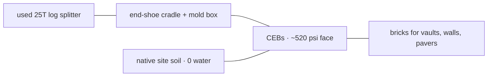
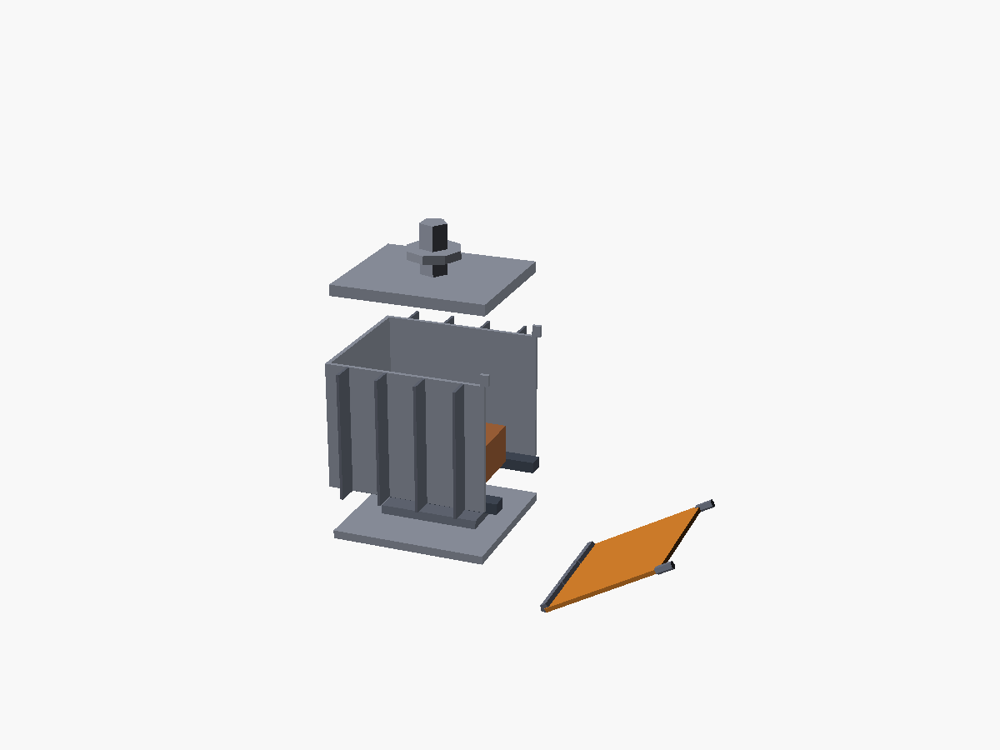

Design

Don't build a press — buy one that's already engineered. A towable log splitter is
a powered horizontal hydraulic press: I-beam frame, 25-ton cylinder, engine-driven
two-stage pump, valve, reservoir, hoses — factory-matched for ~$350 used. The only
part we fabricate is the mold box, and it clamps on so the machine unbolts back to
a log splitter.

## The mold — the one built part

- **Bore**: 3/8–1/2″ plate, ~⅛″ oversize on the largest product; bolt-in liner sets
  change product size — one master bore, swap liners
- **Platen**: ~1″ plate, 1/16″ under bore, stub shaft to the cylinder nose
- **Dead-stop collar** on the stub — brick height is set mechanically, not by feel
- **Bottom-hinge eject door** — drops flat = take-off shelf at bed level
- **Top fill gate** = the dose door

## Mount + plumbing — zero alteration

- **End-shoe cradle** wraps the beam *end*: 1/2″ end plate (abutment) + 3/8″ top
  strap + cheek plates through-bolted below the bottom flange. Mold force bears on
  the beam end face — pure bearing, no drilling or welding to the splitter.
  Clamps carry positioning only, never the 50,000 lbf reaction
- Stock cylinder stays plumbed to its own pump. One in-line gauge tee (~$20) —
  the gauge doubles as the crush-test readout: **the press is its own QC rig**

## Force budget — size bricks to YOUR splitter

face psi = tons × 2,000 ÷ brick face in² · target 500–1,500 psi

| Splitter | Brick face range | Example products |
|---|---|---|
| 20T | 27–80 in² | 8×10 dome · 6×12 wall · 8×8 paver |
| **25T** | **33–100 in²** | **8×10 dome · 6×12 wall · 10×10 paver · 8×12 jumbo (~520 psi)** |
| 35T | 47–140 in² | 10×14 dome · 8×10 wall |

Undersize the brick — never the force. `files/brick_calc.py press` prints the table
for any tonnage.

## Cycle + QC (all gates free)

dose (marked scoop = volumetric) → close gate → extend to dead-stop → dwell ~3 s →
retract → shoe out → push-through eject → rack to air-cure. ~1–2 bricks/min manual.

- Thickness ±1/16″ · drop test every 50th · 24-hr soak per batch · crush = gauge
  pressure at failure → MPa
- Soil gates decide viability before a single brick: jar test (clay %), squeeze-ball
  (~4–6% native moisture — mist liters/ton only if under 4%), soak/efflorescence
  (salinity). A failed soil is a site finding, never a purchase

## Upgrade paths (optional, never gating)

- **Swap cylinder** 5.5–6″ bore → 35–42T on the same pump (on-hand rebuildable cyl
  pending bore + chrome check); add a channel stiffener under the press zone
- **Auto-cycle**: wiper motor + cam + limit switches on the valve lever (~$30–80)
- **Auto-dose**: wiper-motor drawer hopper (~$50–150)

## What it's for — first application

A two-room earth gatehouse: 14-ft form-free lean vault, battered rib walls, six
stepped counterforts, ~3,050 brick-equivalents, ~55 yd³ of shaped earth, ~9–11 days
solo. Interactive model: [open the 3-D viewer](../viewer/). Screening (in-house,
not certified): composite kern ~8.6–11g bound, static FoS ~3.3, loose-fill floor
~0.76g → plinth keys + compacted lifts mandatory.

## Parts

{{ parts_list }}

## Files

{{ files_list }}
