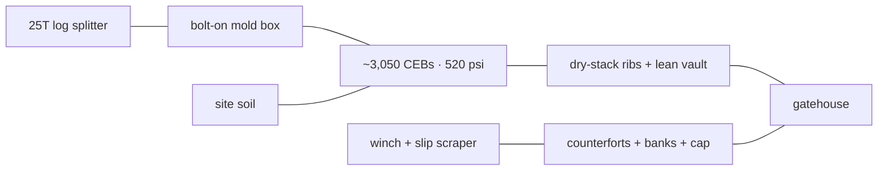

Design

Two machines, one weldment, and a lot of dirt. A stock log splitter is already a
powered horizontal press — add a mold box that clamps onto the beam end and it makes
compressed-earth bricks. Stack those bricks dry into a vault that leans against its
own back wall (the Nubian trick — no formwork), and park shaped soil against it for
mass and weather. What comes out is a storm-sheltered two-cell gatehouse built from
the ground it stands on.

**Interactive model:** [open the 3-D viewer](../viewer/) — drag to orbit, buttons for
exterior / section / interior.

## The press

- Beam = frame, cylinder = ram, engine + two-stage pump + valve + reservoir = power
  pack. Zero alteration — the mold mounts on an end-shoe cradle and unbolts to stock
- The mold is the only fabricated part: 3/8–1/2″ plate bore, ~1″ platen, dead-stop
  collar (brick height is set mechanically), bottom-hinge eject door, top fill gate
- Force budget: 25 tons over an 8×12″ face ≈ 520 psi — mid-band for CEB compaction.
  Standard bricks for vault curves; jumbos for walls. An on-hand rebuildable
  cylinder (5.5–6″ bore pending measure) is the 35–42T upgrade path
- QC gates are free: the gauge reads crush pressure at failure — the press is its
  own test rig. Thickness ±1/16″, drop test every 50th, soak test per batch

## The structure

- **14 ft clear-span vault**, ~8″ shell, 12 courses leaning ~15° onto the party wall —
  every course is supported by the wall and the previous course, which is why a
  single cheap gantry can place them (research systems need cooperative support
  robots; this geometry doesn't)
- **Two cells**: front hall 14×8 ft, rear cell 14×5 ft behind the party-wall door,
  vented by a stack, closed by a stepped rear gable
- **Battered rib walls** (~6″ wythes + compacted soil core) on plinth keys below grade
- **Six stepped counterforts** (3/side) carry the thrust as low, wide, positioned
  mass — better abutments than the berm they replaced, at ~40% of the earthwork
- **Envelope**: ~44″ haunch banks + ~10″ armored cap + paver armor + storm threshold —
  weather/dust duty, not primary restraint
- **Acoustics**: echea cavities + woofer discs embedded in the ribs — the gatehouse
  is a passive bass instrument for the venue it fronts

## Numbers (screening, not certification)

| Metric | Value |
|---|---|
| Brick-equivalents | ~3,050 |
| Earth moved | ~55 yd³ |
| Solo schedule | ~9–11 days all-in (3–4 press, 2.5 stack, 5–6 scrape) |
| Composite kern bound | ~8.6–11g |
| Static sheltered FoS | ~3.3 |
| Incoherent loose-fill floor | ~0.76g — plinth keys + compacted lifts mandatory |
| Machine + site materials | ~$700 core / ~$1,100 incl. teleop + stove |

!!! warning "Honest limits"
    These are in-house screening numbers (kern/membrane/residual checks in
    `files/venue_battle.py`), not code-certified ratings. Occupancy use needs
    licensed structural/geotech/life-safety review.

## Mars path

The method was chosen for transfer: dry-compacted regolith blocks are a published
route; gravity helps (0.38g scales thrust and confinement together); the shell is a
radiation shield around a pressurized bladder, never the pressure vessel; shielding
claims require >1 m cover. Teleop here proves the task is remote-buildable — Mars
itself needs supervised autonomy (4–24 min light delay).

## Parts

{{ parts_list }}

## Files

{{ files_list }}
