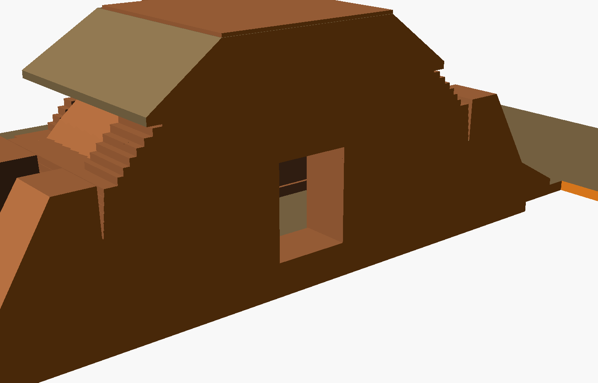

# Earth Vault — Splitter CEB Press

**Status:** Design complete — pre-build

**Maker:** TerexitariusStomp · Mars College Dept of Makers, 2026

## Documentation

- [Design](design.md)
- [Project Log](log.md)
- [Build It Yourself](build-it.md)

**Brief Summary:**
A used 25-ton log splitter becomes a hydraulic brick press (the beam is the frame,
the cylinder is the ram — the only fabricated part is a bolt-on mold). Site soil —
nothing else — becomes a two-room vaulted gatehouse: a 14-ft-span form-free vault,
an open arched mouth, a rear cell with a door, and stepped earthen counterforts
instead of a concrete footing. No added water, no cement, no rebar, no formwork.
Every step is also a rehearsal for building the same way on Mars.

## References:

- Nubian vault tradition (form-free leaning courses) — Association La Voûte Nubienne
- "Direct Formation of Structural Components Using a Martian Soil Simulant" — Nature Scientific Reports (dry-compressed regolith blocks)
- "Microbially induced calcite precipitation can consolidate martian and lunar regolith simulants" — PLOS One (MICP binder fallback)
- NASA ARMADAS (Science Robotics 2024), VaultBot — autonomous discrete-block assembly
- Open Source Ecology CEB press; Cal-Earth superadobe (nearest earth-vessel rival)
